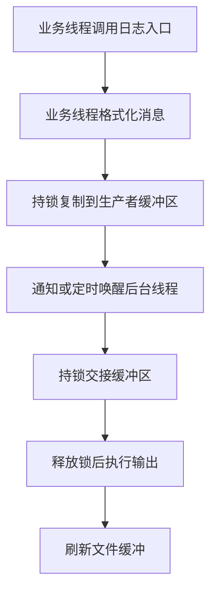

# dlog 与 Kama 异步日志参考实现对比及改造路线

## 1. 范围与结论

- 整理日期：2026-11-02。
- 当前项目：dlog，基线提交 `0ddc46eca79ba55460cd8dc5a14f714442ac3b59`，版本声明为 `1.0.3`。
- 参考项目：[Kama-AsynLogSystem-CloudStorage / log_system/logs_code](https://github.com/youngyangyang04/Kama-AsynLogSystem-CloudStorage/tree/main/log_system/logs_code)，以本次读取的 `main` 分支源码为依据。
- 比较范围：日志入口、消息格式化、缓冲区、异步线程、文件输出与轮转、日志器管理，以及该目录内的远程备份客户端。未审查仓库其他目录中的云存储服务端。
- 本文是阅读和后续改造指南；路线中的事项尚未实施。参考链接指向动态的 `main` 分支，后续阅读时应核对源码是否变化。

两边都采用“业务线程生成日志并写入内存，后台线程批量输出”的模型。dlog 更侧重可组合的轻量日志库；参考实现集成了命名日志器、多输出端、配置读取和远程备份。

后续优先完善 dlog 的容量溢出反馈、FATAL 刷新、后台错误处理和积压控制。多日志器、输出端框架、线程池、远程备份等功能，在出现实际使用需求后再迁移。

## 2. 联系与组件对应关系

2026-11-03 进展：已迁入基于 `vector<char>` 的 Buffer，并将其接入 LogStream 和 Logger，单条日志按需增长、完整交付。异步后端仍沿用 LargeBuffer 分块队列；下文对比表保留第 1 节所列原始基线，前端超长日志丢失问题已在本轮修复。FATAL 异步刷新、后台错误反馈和积压限制仍待后续处理。

### 2.1 共同的数据流

两边的“异步”主要发生在输出阶段。格式化、内存复制、互斥锁竞争，以及必要的分配或扩容仍发生在业务线程，不能把其中任一实现理解为无锁日志系统。

### 2.2 组件对应表

| 职责 | dlog | 参考实现 | 阅读重点 |
| --- | --- | --- | --- |
| 用户入口 | `DLOG_INFO() << value` | `Info(fmt, ...)`、默认日志宏 | 调用时机、参数类型、宏污染范围 |
| 消息格式化 | `Logger`、`LogStream` | `AsyncLogger`、`LogMessage` | 业务线程实际承担的工作 |
| 异步调度 | `AsyncLogging` | `AsyncWorker` | 唤醒、交接、停止条件 |
| 内存缓冲 | `FixedBuffer` | `Buffer` | 容量不足时的处理 |
| 文件输出 | `LogFile`、`FileUtil` | `FileFlush`、`RollFileFlush` | 部分写入、刷新、关闭、轮转 |
| 输出扩展 | `Logger::SetOutput()` 回调 | `LogFlush` 抽象类和输出端列表 | 是否确有多输出需求 |
| 日志器管理 | 进程共享输出配置 | `LoggerManager` | 命名、所有权和线程数量 |
| 远程备份 | 当前没有 | `start_backup()`、`ThreadPool` | 网络等待是否影响业务线程 |

相似的组件分工不能单独证明直接移植关系。dlog 的 [logstream.h](../src/core/logstream.h) 明确引用的是同一作者的另一个仓库 `youngyangyang04/kamaLog` 中的 `logger/LogStream.h`，与本文比较的目录不同。

## 3. 核心差异

### 3.1 缓冲组织、积压与唤醒

| 方面 | dlog 当前行为 | 参考实现当前行为 | 对使用方的影响 |
| --- | --- | --- | --- |
| 缓冲组织 | 固定大小缓冲块，加待写缓冲块队列 | 生产者和消费者两个缓冲区交换 | 交接结构不同，不能直接按类名替换 |
| 初始容量 | `SmallBuffer` 为 4,000 字节；`LargeBuffer` 为 4,000,000 字节 | 配置中的每个 `Buffer` 初始为 10,000,000 字节 | 前者两种容量属于不同处理阶段；后者有两个初始缓冲区 |
| 空间不足 | 写满的块移入队列，分配新块 | SAFE 模式等待空间；UNSAFE 模式扩容 | 分别把压力传给内存或业务线程等待时间 |
| 超大后端追加 | 一次 `append()` 可跨越多块，整次调用持同一把锁 | SAFE 可能一直等待；UNSAFE 的单次扩容未保证足够 | 必须单独验证超容量输入 |
| 后台唤醒 | 整块入队后通知；未满数据定时处理，默认间隔 3 秒 | 每次 `Push()` 都通知消费者 | 参考实现唤醒更积极，dlog 更偏向批量处理 |
| 缓冲交接 | 交换缓冲块指针组成的队列 | 交换两个 `vector<char>` 的存储 | 交接避免重新复制整批字节，但前台入缓冲仍有复制 |
| 内存上限 | 队列没有容量上限 | SAFE 主要靠等待控制积压；UNSAFE 继续增长 | 固定块大小不等于总内存固定 |
| 缓冲复用 | 后台保留一块用于下一轮替换；前台写满时仍可能分配 | 两个缓冲区循环交换和重置 | dlog 的分配频率需要在性能分析中观察 |

源码入口：[dlog AsyncLogging](../src/core/asynclogging.cpp)、[dlog FixedBuffer](../src/core/fixedbuffer.h)、[参考 AsyncWorker.hpp][ref-worker]、[参考 AsyncBuffer.hpp][ref-buffer]、[参考 config.conf][ref-config]。

注意：参考实现的 `ASYNC_SAFE` 主要表达容量等待策略，不能据此认为停止流程、超大消息或文件错误处理已经可靠。

dlog 当前在持锁状态下分配下一块 `LargeBuffer`，其中字符数组会初始化。高频写入时，应观察这部分耗时及其对其他生产者的影响；是否需要增加备用块，先由测量决定。

### 3.2 接口、格式与功能

| 方面 | dlog | 参考实现 |
| --- | --- | --- |
| 默认输出 | 同步输出 stdout，调用方通过回调连接异步后端 | 创建 `AsyncLogger` 时即创建异步工作器 |
| 日志器数量 | `Logger` 使用进程共享的输出和刷新配置；后端对象可以自行创建 | `LoggerManager` 按名字管理日志器，每个日志器有自己的工作器 |
| 输出扩展 | 单个输出回调可由调用方组合多个目标 | 同一批数据依次调用多个 `LogFlush` 输出端 |
| 格式化 | 流式拼接，固定单条缓冲，数值使用 `to_chars` | `vasprintf`、字符串拼接、`stringstream` |
| 时间和元信息 | 完整日期、微秒、等级、文件名、行号 | 时分秒、线程 ID、等级、日志器名、文件位置 |
| 等级 | TRACE、DEBUG、INFO、WARN、ERROR、FATAL | DEBUG、INFO、WARN、ERROR、FATAL |
| 等级过滤 | 当前入口没有运行时最低等级过滤 | 当前入口也没有运行时最低等级过滤 |
| FATAL | 输出、调用刷新回调，再 `abort()` | 格式化、等待备份任务、提交本地异步输出，没有主动终止进程 |
| 系统错误 | 显式接收调用方保存的 `errno` | 当前入口没有相同的专用接口 |
| 配置 | 构造参数、输出与刷新回调 | JSON 配置、建造者、全局配置指针和线程池指针 |
| 平台 | 有 Windows、Linux 适配及测试配置 | 使用 `vasprintf`、`localtime_r`、POSIX socket 等，偏向 Linux |

源码入口：[dlog Logger](../src/core/logger.h)、[dlog LogStream](../src/core/logstream.h)、[参考 AsyncLogger.hpp][ref-logger]、[参考 Message.hpp][ref-message]、[参考 Manager.hpp][ref-manager]、[参考 MyLog.hpp][ref-entry]。

参考实现已有多输出能力，但所有输出端由同一工作器依次调用；慢输出端会延迟该日志器后续批次。迁移多输出设计前，需要先明确各输出端是否允许相互等待。

### 3.3 文件轮转与刷新语义

| 方面 | dlog | 参考实现 |
| --- | --- | --- |
| 轮转条件 | 本地日期变化，或下一次追加会超过大小阈值 | 当前文件大小已经达到阈值时，在下一批写入前轮转 |
| 文件命名 | 日期加当天序号；启动时扫描当天已有序号 | 时间字段加实例内计数器 |
| 目录 | 调用方预先创建 | 文件输出端尝试创建 |
| 大小硬上限 | 不保证：空文件允许完整接收一次超限追加 | 不保证：写入前没有按本批长度预判 |
| 刷新 | 异步后台每批写完执行 `fflush` | 配置选择默认缓冲、`fflush` 或 `fflush + fsync` |
| 部分写入 | `FileUtil::append()` 按实际写入量循环；流错误时报告并放弃剩余数据 | 输出端调用一次 `fwrite`，未按返回字节数补写 |

源码入口：[dlog LogFile](../src/core/logfile.cpp)、[dlog FileUtil](../src/utils/fileutil.cpp)、[参考 LogFlush.hpp][ref-flush]。

必须区分三个完成点：

1. **已接收**：日志进入异步内存缓冲。
2. **已刷新用户态缓冲**：后台完成写入并调用 `fflush`；这不代表断电后必然保留。
3. **已请求操作系统同步存储**：例如 Linux 上成功执行 `fsync`；仍应处理同步失败并明确平台语义。

参考项目的 `flush_log` 配置为 `2`，会走 `fflush + fsync` 路径。与 dlog 比较吞吐时，必须先对齐刷新语义，否则数字不可直接比较；参考代码也没有完整检查该路径所有返回值。

异步后台交给 `LogFile::append()` 的通常是一块缓冲数据，不能把 `rollSize` 理解为每条日志的边界。跨缓冲块的记录也可能跨文件，当前没有按日志行切分文件的保证。

### 3.4 远程备份的实际行为

参考实现仅在 ERROR、FATAL 路径提交备份任务，随后立即调用 `future.get()`，任务结束后才提交本地异步缓冲。

因此，这条路径会把网络连接、重连和发送耗时传回业务线程；线程池的存在并不代表调用方无需等待。备份客户端使用 TCP 连接并调用一次 `write`，也没有完成部分发送补写和应用层确认。

阅读入口：[AsyncLogger::serialize()][ref-logger] → [ThreadPoll.hpp][ref-pool] → [backlog/CliBackupLog.hpp][ref-backup]。

后续若需要远程备份，应先明确本地记录与远端发送的先后关系、失败行为和等待边界，再决定是否引入独立工作线程。

## 4. dlog 优先处理的问题

以下项目是改造建议，尚未实现。优先级以日志完整性、可诊断性和改动范围为依据。

| 优先级 | 问题与触发条件 | 当前后果 | 最小改造方向 | 涉及位置 |
| --- | --- | --- | --- | --- |
| P0 | 单条格式化日志超过 `SmallBuffer` 剩余容量 | 本次字段追加被静默忽略，可能缺正文或换行；后端无法恢复 | 明确超长日志策略，提供可见的溢出反馈，并保证记录边界 | `FixedBuffer`、`LogStream`、`Logger` 及对应测试 |
| P0 | 只设置异步 `SetOutput()` 后输出 FATAL | 默认刷新函数仍刷新 stdout，随后 `abort()`；致命日志可能留在异步队列 | 接通异步刷新回调，明确等待到哪个完成点 | `Logger::SetFlush()`、`AsyncLogging`、README 和异步示例 |
| P0 | 后台打开、轮转或刷新文件抛出异常 | 线程入口未捕获，可能终止进程；前台难以获知后端故障 | 在后台边界处理异常并提供最小错误反馈，避免再次走故障日志链路 | `AsyncLogging::threadFunc()`、`LogFile`、`FileUtil` |
| P1 | 生产速度持续超过写入速度 | 待写缓冲块无上限，可能耗尽内存 | 为积压设置上限，并选择一种清晰的满载策略 | `AsyncLogging::append()`、消费循环、停止流程 |
| P1 | 未结束生产者就切换回调、停止或销毁后端 | 可能出现停止后追加、回调悬空或并发配置修改 | 明确并验证调用顺序，先完善接入文档和示例 | README、异步示例、集成测试 |
| P2 | 测量确认持锁分配或低流量延迟影响使用 | 延迟波动，或少量日志等待定时处理 | 按测量结果选择备用块或唤醒策略的小改动 | 前台块轮换、后台等待逻辑 |

P0 表示优先阅读和处理，不表示本文已完成故障注入或证明所有执行场景都会触发。

FATAL 的最小接入方向可以先采用“刷新回调等待后端停止并排空”，因为当前 FATAL 随即终止进程；若之后需要正常运行中的同步刷新，再设计可重复使用的刷新操作。无论采用哪种方式，都需要检查回调执行线程、后端生命周期和异常处理，避免后台线程等待自身。

增加积压等待时，必须保留停止唤醒和超大消息的退出路径。还要重新验证跨块追加的顺序，不能只增加一个条件变量就认为改造完成。

## 5. 阅读参考实现时需要识别的问题

这些结论来自本次源码静态分析，未在参考项目中运行复现。

| 问题 | 最小场景或判断依据 | 阅读与迁移时的处理 |
| --- | --- | --- |
| 停止时可能遗漏尾部 | 后台正输出 A，生产者缓冲已有 B，此时 `stop_ = true`；A 写完后下一次 `while (!stop_)` 直接退出，B 未处理 | 保留 dlog 的“停止请求到达且待处理数据为空才退出”的规则 |
| SAFE 模式超大消息可能一直等待 | 条件是 `len <= WriteableSize()`；若 `len` 大于缓冲区总容量，交换出空缓冲区也无法满足 | 先决定拒绝或分段策略，再加入容量等待 |
| UNSAFE 模式可能越界写入 | `ToBeEnough()` 只扩容一次，随后直接复制；容量 10,000,000 时会扩到 30,000,000，但一次追加 31,000,000 仍放不下 | 扩容后必须满足“可写空间不少于本次长度”，并检查容量计算溢出 |
| 重复停止存在异常风险 | `Stop()` 无条件调用 `thread_.join()`；显式停止后析构还会再次停止 | 保留 dlog 当前重复停止安全的行为 |
| 文件错误处理不完整 | 打开失败只打印错误后仍可能继续使用空 `FILE*`；单次 `fwrite` 未补写 | 复用并完善 dlog 的文件层处理，不直接替换 |
| 文件资源回收不完整 | `FileFlush`、`RollFileFlush` 没有负责关闭当前 `FILE*` 的析构逻辑 | 保留 dlog 的文件对象所有权和析构关闭方式 |
| 错误日志等待远端 | `enqueue()` 后立即 `get()` | 单独测量并明确网络失败时本地日志与业务线程的行为 |

对应源码：[AsyncWorker.hpp][ref-worker]、[AsyncBuffer.hpp][ref-buffer]、[LogFlush.hpp][ref-flush]、[AsyncLogger.hpp][ref-logger]。

## 6. 推荐阅读顺序

每一轮先看参考代码，再对照 dlog；读完后回答表中的问题，再决定是否改动。

| 顺序 | 参考文件 | dlog 对照文件 | 读完应能回答的问题 |
| --- | --- | --- | --- |
| 1 | [MyLog.hpp][ref-entry]、[Level.hpp][ref-level]、[Message.hpp][ref-message] | [logger.h](../src/core/logger.h)、[logger.cpp](../src/core/logger.cpp)、[logstream.h](../src/core/logstream.h) | 一条日志什么时候形成？格式化在哪个线程？FATAL、超长消息和等级过滤有什么语义？ |
| 2 | [AsyncBuffer.hpp][ref-buffer] | [fixedbuffer.h](../src/core/fixedbuffer.h) | 容量、有效长度、读写位置和扩容分别由谁维护？一次追加放不下怎么办？ |
| 3 | [AsyncWorker.hpp][ref-worker] | [asynclogging.h](../src/core/asynclogging.h)、[asynclogging.cpp](../src/core/asynclogging.cpp) | 锁保护哪些状态？什么时候唤醒？谁拥有待写数据？停止时如何排空？ |
| 4 | [LogFlush.hpp][ref-flush] | [logfile.cpp](../src/core/logfile.cpp)、[fileutil.cpp](../src/utils/fileutil.cpp) | 写入、刷新、同步存储有何区别？轮转按批次还是记录？错误如何上报？ |
| 5 | [Manager.hpp][ref-manager]、[AsyncLogger.hpp][ref-logger] 中的建造者 | [README](../README.md)、[异步示例](../snippet/AsyncLoggingTest/main.cpp) | 现有回调是否已够用？多日志器需要多少线程？配置和生命周期归谁管理？ |
| 6 | [Util.hpp][ref-util]、[config.conf][ref-config] | 构造参数、现有初始化代码 | 配置加载失败和非法容量如何处理？是否确实需要配置文件？ |
| 7 | [ThreadPoll.hpp][ref-pool]、[CliBackupLog.hpp][ref-backup] | 当前无对应模块 | 谁等待网络？如何处理部分发送、超时和重试？远端失败是否阻塞本地记录？ |

建议第 1～4 轮与核心正确性改造结合，第 5～7 轮按功能需求推进。

## 7. 分阶段改造与验收清单

### 阶段一：明确并补齐消息完整性和故障行为

- [ ] 明确超长消息策略：截断并标记、拒绝并反馈，或支持增长；先选择满足当前需求的一种。
- [ ] 验证总容量包含时间、等级、文件位置、正文和换行，避免刚好填满时丢失记录边界。
- [ ] 接通异步 FATAL 刷新，使用独立子进程验证退出前文件中存在预期致命日志。
- [ ] 明确写入失败时的报告方式；覆盖目录不存在、打开失败、刷新失败等可控场景。
- [ ] 更新 README 和异步示例，明确先停止生产者、切换回调，再停止或销毁后端的顺序。

涉及范围：`src/core/fixedbuffer.h`、`src/core/logstream.*`、`src/core/logger.*`、`src/core/asynclogging.*`、`src/utils/fileutil.*`、`test/core`、`test/utils/fileutil_test.cpp`、`README.md` 和异步示例。按实际方案只修改必要文件。

验收：普通日志输出保持兼容；超长消息行为可见且可验证；FATAL 不仅执行刷新回调，还实际等待预期异步数据完成；后端失败不会静默消失或递归记录。

### 阶段二：限制积压并验证并发生命周期

- [ ] 明确允许的积压字节数或缓冲块数量，容量统计应说明是否包含当前生产块和后台正在写的批次。
- [ ] 选择阻塞、丢弃或拒绝中的一种满载策略，并提供必要反馈。
- [ ] 使用可控的慢输出场景验证积压限制，不依赖真实磁盘偶然变慢。
- [ ] 验证超大追加、多个生产者、满载停止和后台错误时都不会永久等待。
- [ ] 保留重复 `start()`、重复 `stop()`、停止后重启和尾部排空的既有行为。

验收：积压符合定义的上限；停止时等待者能退出；没有因容量等待引入记录交错、丢失、重复或死锁。

### 阶段三：按需求迁移功能

| 功能 | 启动迁移的条件 | 优先尝试的最小方案 | 验收重点 |
| --- | --- | --- | --- |
| 同时写文件和终端 | 明确需要同一条日志输出到两个目标 | 先在现有输出回调中组合目标 | 两端内容、颜色设置、慢目标影响 |
| 命名日志器 | 不同模块确实需要独立配置或输出 | 在保留现有宏兼容性的前提下增加必要对象接口 | 配置隔离、对象生命周期、线程数量 |
| 最低等级过滤 | 需要降低不必要日志的格式化开销 | 在入口处明确过滤行为 | 被过滤消息是否仍计算昂贵参数 |
| 配置文件 | 参数需要由部署环境调整 | 只外置当前确实需要的参数 | 缺失、格式错误、非法容量和路径 |
| 更强存储同步 | 有明确的故障恢复或持久性要求 | 在文件层增加必要的平台同步操作 | 返回值、错误报告和吞吐代价 |
| 远程备份 | 已有明确的接收端和可靠性要求 | 先定义本地与远端的先后关系，再实现发送 | 超时、部分发送、重试、重复记录和停机排空 |

这些功能均为候选项，不要求全部实现。工厂、建造者和线程池只有在具体需求需要时才引入。

### 阶段四：统一条件后比较性能

- [ ] 固定消息长度、生产者数量、总数据量、文件轮转大小和测试时长。
- [ ] 对齐刷新语义，分别比较普通缓冲、`fflush` 和需要时的存储同步路径。
- [ ] 将 ERROR/FATAL 的远程备份路径与普通本地日志分开测试。
- [ ] 同时记录业务线程调用延迟、整体吞吐、峰值内存和停止排空耗时。
- [ ] 检查实际落盘字节和记录数量，避免以丢日志换取表面吞吐。
- [ ] 测量确认分配或唤醒是瓶颈后，再优化对应位置。

## 8. 本次验证与边界

本次比较时，直接运行本机已有的 `build/windows/x64/debug/test/tests_core.exe`，选择异步日志、日志流、文件轮转及 Logger 相关测试，共 **78 项通过，其中 AsyncLoggingTest 为 13 项**。

异步测试源码见 [asynclogging_test.cpp](../test/core/asynclogging_test.cpp)，覆盖空运行、尾部排空、启动前追加、嵌入空字节、缓冲区边界、跨多块追加、周期刷新、重复启动停止、重启、析构排空和多个生产者。

验证限制：

- 常规 `xmake test` 因 `cannot create filelock for package(ninja)!` 失败；上述结果来自已有测试程序，本次未重新编译。
- 既有 FATAL 测试验证回调与进程终止行为，不等于已经覆盖“异步文件后端排空后再退出”的集成场景。
- 未运行参考项目、远程备份服务、压力测试、存储故障注入或两边的性能对测。
- 测试通过不能替代对积压上限、后台异常和持久性语义的设计与验证。

## 9. 参考源码索引

- [参考目录][ref-root]
- [AsyncBuffer.hpp][ref-buffer]：缓冲区、读写位置与扩容。
- [AsyncWorker.hpp][ref-worker]：生产者等待、缓冲交换与停止流程。
- [AsyncLogger.hpp][ref-logger]：格式化入口、备份调用、输出端遍历、建造者。
- [LogFlush.hpp][ref-flush]：终端输出、文件输出、轮转与同步。
- [Manager.hpp][ref-manager]：命名日志器管理。
- [Message.hpp][ref-message]、[Level.hpp][ref-level]、[MyLog.hpp][ref-entry]：记录格式、等级与用户入口。
- [Util.hpp][ref-util]、[config.conf][ref-config]：配置及辅助工具。
- [ThreadPoll.hpp][ref-pool]、[backlog/CliBackupLog.hpp][ref-backup]：线程池和备份客户端。

[ref-root]: https://github.com/youngyangyang04/Kama-AsynLogSystem-CloudStorage/tree/main/log_system/logs_code
[ref-buffer]: https://github.com/youngyangyang04/Kama-AsynLogSystem-CloudStorage/blob/main/log_system/logs_code/AsyncBuffer.hpp
[ref-worker]: https://github.com/youngyangyang04/Kama-AsynLogSystem-CloudStorage/blob/main/log_system/logs_code/AsyncWorker.hpp
[ref-logger]: https://github.com/youngyangyang04/Kama-AsynLogSystem-CloudStorage/blob/main/log_system/logs_code/AsyncLogger.hpp
[ref-flush]: https://github.com/youngyangyang04/Kama-AsynLogSystem-CloudStorage/blob/main/log_system/logs_code/LogFlush.hpp
[ref-manager]: https://github.com/youngyangyang04/Kama-AsynLogSystem-CloudStorage/blob/main/log_system/logs_code/Manager.hpp
[ref-message]: https://github.com/youngyangyang04/Kama-AsynLogSystem-CloudStorage/blob/main/log_system/logs_code/Message.hpp
[ref-level]: https://github.com/youngyangyang04/Kama-AsynLogSystem-CloudStorage/blob/main/log_system/logs_code/Level.hpp
[ref-entry]: https://github.com/youngyangyang04/Kama-AsynLogSystem-CloudStorage/blob/main/log_system/logs_code/MyLog.hpp
[ref-util]: https://github.com/youngyangyang04/Kama-AsynLogSystem-CloudStorage/blob/main/log_system/logs_code/Util.hpp
[ref-config]: https://github.com/youngyangyang04/Kama-AsynLogSystem-CloudStorage/blob/main/log_system/logs_code/config.conf
[ref-pool]: https://github.com/youngyangyang04/Kama-AsynLogSystem-CloudStorage/blob/main/log_system/logs_code/ThreadPoll.hpp
[ref-backup]: https://github.com/youngyangyang04/Kama-AsynLogSystem-CloudStorage/blob/main/log_system/logs_code/backlog/CliBackupLog.hpp

